# Notes App Backend

[](https://github.com/hendisantika/Notes-App/actions/workflows/maven.yml)


[](.github/dependabot.yml)

## Overview

This project implements a robust RESTful API using Spring Boot with the following features:

- **JWT Token Authentication:** Secure user authentication using JSON Web Tokens.
- **Rate Limiting and Request Throttling:** Manage high traffic by limiting requests per user.
- **Search Functionality:** Efficient keyword-based search for user notes.
- **Note Sharing:** Share a note with another user.
- **OpenAPI / Swagger UI:** Interactive API documentation with JWT bearer support.

## API Endpoints

### Authentication

- **POST /api/auth/signup:** Create a new user account.
- **POST /api/auth/signin:** Log in to an existing user account and receive an access token.

### Note Management

- **GET /api/notes/:** Get a list of all notes for the authenticated user.
- **GET /api/notes/{noteId}:** Get a note by ID for the authenticated user.
- **POST /api/notes/:** Create a new note for the authenticated user.
- **PUT /api/notes/{id}:** Update an existing note by ID for the authenticated user.
- **DELETE /api/notes/{id}:** Delete a note by ID for the authenticated user.
- **POST /api/notes/{noteId}/share:** Share a note with another user for the authenticated user.

### Search

- **GET /api/notes/search?query={keyword}:** Search for notes based on keywords for the authenticated user.

### API Documentation

- Swagger UI: http://localhost:8080/swagger-ui
- OpenAPI spec: http://localhost:8080/v3/api-doc
- Postman collection: [`Notes App.postman_collection.json`](Notes%20App.postman_collection.json)

## Technologies Used

| Category        | Technology                                              |
|-----------------|---------------------------------------------------------|
| Language        | Java 25 (LTS)                                           |
| Framework       | Spring Boot 4 (Web MVC, Security 7, Data JPA, Validation) |
| Database        | PostgreSQL 17, Hibernate 7 / JPA                        |
| Auth            | JWT (jjwt)                                              |
| API Docs        | springdoc-openapi (Swagger UI)                          |
| Testing         | JUnit 5, Testcontainers 2 (PostgreSQL)                  |
| Build           | Maven Wrapper (Maven 3.10)                              |
| Container       | Docker (Eclipse Temurin 25), Docker Compose             |
| CI/CD           | GitHub Actions, Dependabot                              |

## Prerequisites

Before starting, ensure you have the following installed on your machine:

- [JDK 25](https://adoptium.net/temurin/releases/?version=25) (Eclipse Temurin recommended)
- [Docker](https://docs.docker.com/get-docker/) & Docker Compose (for PostgreSQL and Testcontainers)
- [Git](https://git-scm.com/downloads)
- [Postman](https://www.postman.com/downloads/) (optional)

> Maven does not need to be installed: use the bundled Maven Wrapper (`./mvnw`).

## Getting Started

### 1. Clone the Repository

```bash
git clone https://github.com/hendisantika/Notes-App.git
cd Notes-App
```

### 2. Configure PostgreSQL

The default configuration in `src/main/resources/application.properties` matches the bundled `compose.yml`:

```properties
spring.datasource.url=jdbc:postgresql://localhost:5432/notes
spring.datasource.username=yuji
spring.datasource.password=S3cret
```

Thanks to `spring-boot-docker-compose`, the PostgreSQL container from `compose.yml` is started automatically when you
run the app. You can also start it manually:

```bash
docker compose up -d
```

### 3. Run the Application

```bash
./mvnw clean spring-boot:run
```

The API is available at http://localhost:8080.

### 4. Run the Tests

Tests use Testcontainers, so Docker must be running:

```bash
./mvnw clean verify
```

### 5. Run with Docker

```bash
docker build -t notes-app .
docker run --rm -p 8080:8080 \
  -e SPRING_DATASOURCE_URL=jdbc:postgresql://host.docker.internal:5432/notes \
  notes-app
```

Prebuilt images are published to Docker Hub as [`hendisantika/notes-app`](https://hub.docker.com/r/hendisantika/notes-app)
(`latest`, short commit SHA and timestamp tags).

### 6. Test with Postman

Import the Postman collection, sign up, sign in, then use the returned token.

#### Make sure that proper authentication bearer token is added to access notes.

## CI/CD

- **GitHub Actions** (`.github/workflows/maven.yml`):
  - Builds and tests the project with JDK 25 using the Maven Wrapper (`./mvnw verify`).
  - Uploads the jar and Surefire test reports as workflow artifacts.
  - Builds the Docker image on every pull request and pushes it to Docker Hub only on pushes to `main`.
- **Dependabot** (`.github/dependabot.yml`):
  - **Maven** (daily): grouped updates for Spring Boot, springdoc, jjwt, Testcontainers and Maven plugins/wrapper.
  - **GitHub Actions**, **Docker** and **Docker Compose** (weekly).
  - Major upgrades of Spring Boot and the JDK base image are ignored and done manually.

### Screenshots

- SignUp
  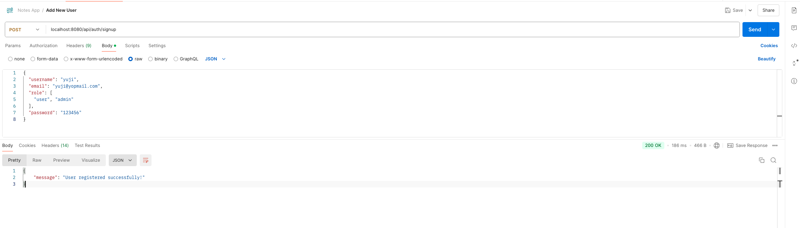

- 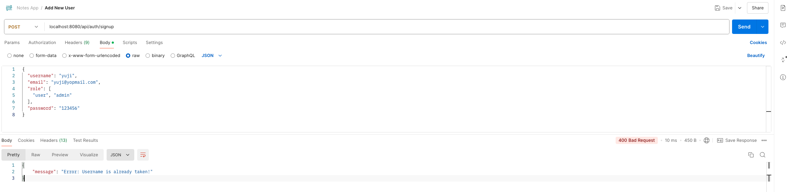

- SignIn
  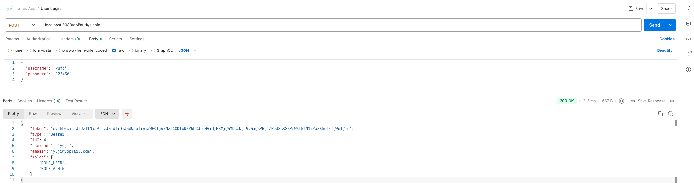

- Authentication Bearer
  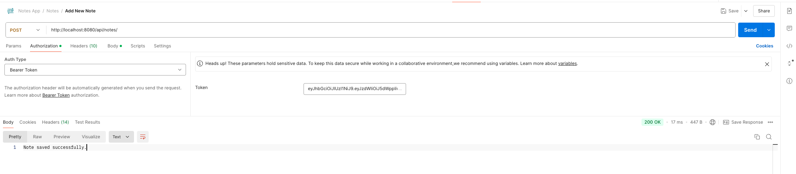

- Get all Notes
  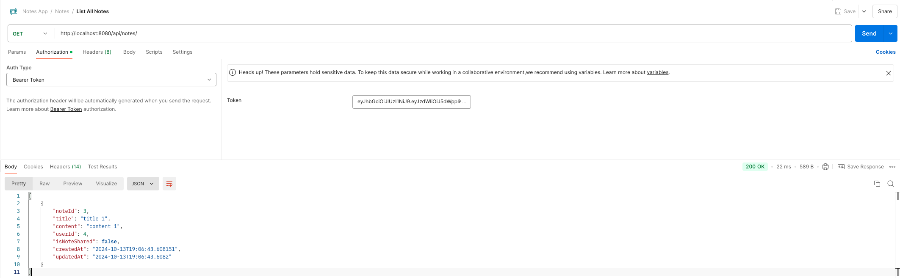

- Get Note by NodeId
  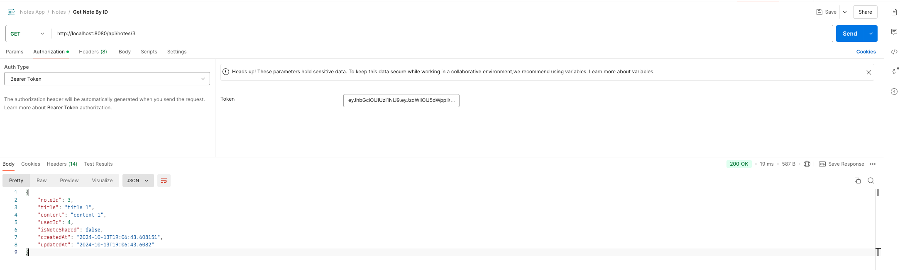

- Save Notes
  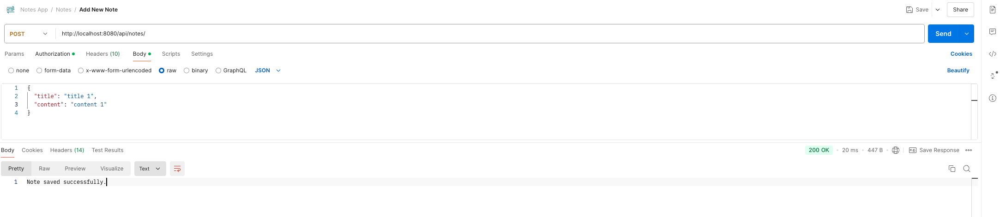

- Update Notes
  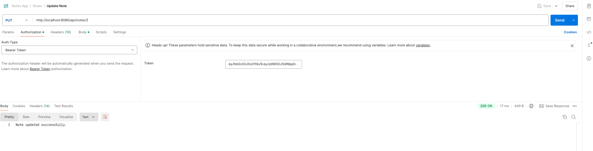

- Delete Notes by NodeId
  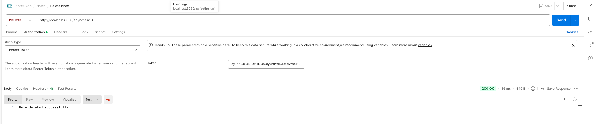

- Search in note title/content
  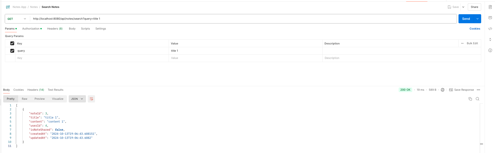

- Notes access denies if note is not owned by that user
  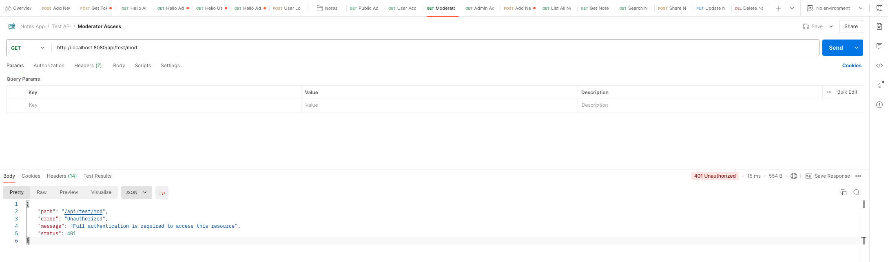
